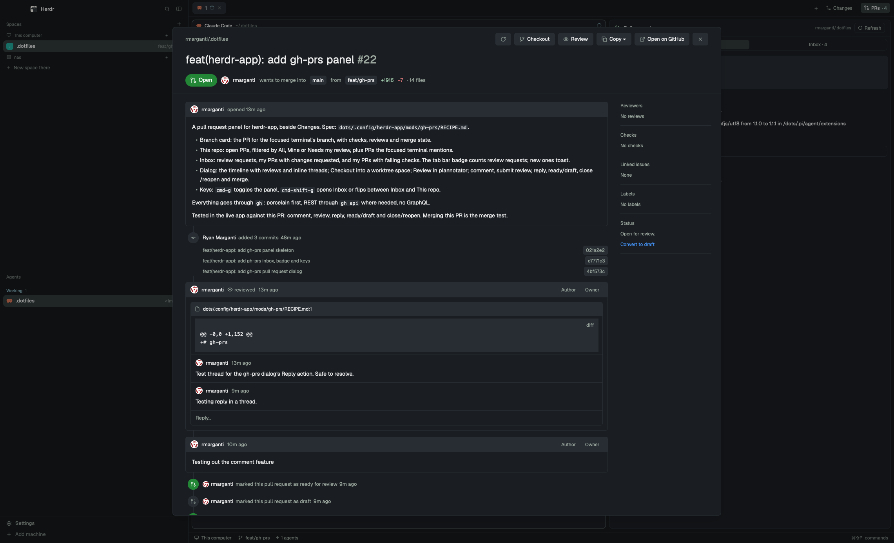

# gh-prs

A pull requests panel beside Files and Changes. It follows the focused terminal: the pull request for that terminal's branch sits on top with its checks and reviews, the repository's open pull requests below. An Inbox tab collects every pull request waiting on you across GitHub, and the tab bar button counts your review requests. Clicking any pull request opens it in a GitHub-style dialog to read the conversation and inline threads, comment, review, reply, merge, check it out into its own space, or review it line by line in plannotator.

## What you see

- **The PRs button**, at the right end of the tab bar after Files and Changes: a 26px pill (6px radius, 12px text) with a pull request icon and "PRs", `selected` while the panel shows, `chrome` otherwise. With review requests waiting it reads "PRs · 4", the count semibold in `accent`.
- **The panel**, in the side panel column as a card: 10px radius, 1px `border`, `background`, 13px text.
  - A 42px header: a pull request icon in `ansi2`, "Pull requests" semibold, the repository (`owner/name`, 11px, `dim`, right-aligned, truncated; blank on Inbox) and a bordered 26px Refresh button, a spinner and "Syncing" while the list loads, or a red "Retry" after it failed.
  - Two equal tabs below it, in a bordered 8px-radius strip: **This repo** and **Inbox** ("Inbox · 4" with review requests waiting). The current one is `selected` and semibold.
- **This repo**, scrolling as one column:
  - **The branch card**, the pull request for the focused terminal's branch: a 6px-margin card, 10px padding, 8px radius, `raised`.
    - A 22px state pill in GitHub's fixed colors, white text: Open `#238636`, Draft `#6e7681`, Merged `#8957e5`, Closed `#da3633`. Then the title, semibold, wrapping.
    - `#N`, `base ← head` (11px, `dim`), `+adds` in `ansi2` and `−dels` in `ansi1`.
    - Checks: "✓ 12 passed" `ansi2`, "✗ 2 failed" `ansi1`, "● 1 running" `ansi3`; then each failing check by name with a red ✗.
    - Reviews: the decision (Approved `ansi2`, Changes requested `ansi1`, Review required `muted`), one line per reviewer (16px avatar, login, their latest verdict) and "Awaiting …" for pending requests.
    - When it can't merge cleanly, one `ansi3` line: "Merge conflicts" or "Behind the base branch".
    - With no pull request: "No pull request for feature/foo" in `dim`. On the default branch, no card at all.
  - **In this terminal**, when the focused terminal mentions pull requests of this repository: up to 8 rows, merged numbers in `ansi5`, closed in `ansi1`.
  - **Open pull requests N**: a 28px "Filter pull requests" field, then **All | Mine | Needs my review**. Rows: `#N` (40px, `dim`), a 16px author avatar, the title (`muted` for drafts), then a bordered "Draft" tag, ✓ `ansi2` when approved or ✗ `ansi1` when changes were requested, and an 8px CI dot: `ansi1` failing, `ansi3` running, `ansi2` passing, none without checks.
  - Before any repository: a centered pull request icon, "No repository yet" and "Focus a terminal inside a GitHub repository."
- **Inbox**: three groups, each headed with its count (11px, semibold, `dim`), empty groups left out: **Review requested**, **Changes requested** (yours), **Failing checks** (yours). A row: 16px avatar, then `owner/repo #N` (11px, `dim`) with a Draft tag and a tag for any other group it's in, then the title. "Nothing waiting on you" when all three are empty.
- **The pull request dialog**, 86% of the window's width but at most 1400px, 90% of its height:
  - A top bar of 32px buttons (6px radius, `raised`, 1px `border`): Back after following a link, the repository, the last error in `ansi1`, a spinner while loading or saving, then Refresh, Checkout, Review, Copy ▾, Open on GitHub and close.
  - The title at 28px, wrapping word by word, `#N` after its last word in `muted`. Below it a 32px state pill (16px radius, same colors as the card), the author's avatar and login, "wants to merge into `base` from `head`", `+adds −dels · N files`.
  - Left, the timeline. Cards have a 38px `raised` header (20px avatar, login, a "bot" badge for bots, "opened 3d ago" or "2h ago", Author and Owner/Member/Collaborator/Contributor badges) and markdown below, with tables, code and images. Reactions are 26px pills under a card.
    - The description, then comments.
    - Reviews: the header says "approved these changes" (✓, border `#238636`), "requested changes" (✗, border `#da3633`) or "reviewed". Their inline threads sit inside: a 34px `raised` bar with the file and line, the last 8 lines of the diff, each comment (18px avatar), and "Reply…" at the bottom. Outdated threads fold to their bar with an "Outdated" badge and "3 comments ▸".
    - Events between cards on a 2px line: a 28px round icon (filled `#8957e5` merged, `#da3633` closed, `#238636` reopened or ready) and "added 3 commits" (with each commit's message and short SHA), "force-pushed the head branch", "requested a review from …", "marked this pull request as ready for review", "merged commit abc1234 into main", label changes.
    - On open pull requests, the merge box: "Ready to merge" in `#238636`, or "Merging is blocked or may fail" with each reason (draft, conflicts, behind, failing or running checks, changes requested, review required). Then a green "Squash and merge" with ▾.
    - "Add a comment": Write and Preview tabs, a box growing from 4 to 14 rows, then Close pull request (or Reopen), Submit review ▾ and a green Comment.
  - Right, a 264px sidebar of sections split by lines: Reviewers (avatar, login, a verdict icon, "pending" in `ansi3`), Checks ("6/8 passed", every check with ✓ ✗ ●, failures first), Linked issues, Labels (GitHub-tinted chips) and, while open, Status ("Ready for review" on drafts, "Convert to draft" otherwise).
- **Copy ▾**, a 300px menu under the button: Copy link, Copy reference (`owner/repo#27`), Copy number, Copy number and title, Copy branch name, each with what it copies below it.

## How it behaves

- **Following focus.** The panel shows the repository of the focused terminal's folder. Each space remembers its last repository: a folder outside any repository keeps it, and a space never in one shows "No repository yet". Focus moving to a mod pane keeps the last folder.
- **This repo** shows cached pull requests at once (after a restart too), then refreshes: the list every 60 seconds and the branch card every 30, both at once when focus moves or the panel comes back. Refresh does both now. Every 3 seconds it reads the focused terminal for `#123` and this repository's pull request links, newest line first.
- **Hidden, it rests.** While another side panel shows, or none, This repo doesn't refresh or read terminals.
- **The inbox runs regardless**, every 3 minutes, from the tab bar button. Opening Inbox refreshes it. The badge counts only review requests: someone waiting on you. A review request that wasn't there before posts a toast, "Review requested: owner/repo#766: title"; clicking it opens the panel on Inbox. The first refresh after starting posts none.
- **Keys:** `cmd-g` shows or hides the panel on whichever tab it was on. `cmd-shift-g` with the panel hidden shows it on Inbox; with it shown, flips between Inbox and This repo.
- **Clicks:** the PRs button shows or hides the panel. A branch card or any row opens the dialog; right-clicking one opens the copy menu at the pointer. A failing check on the card opens its run in the browser.
- **The dialog** loads in a second or two. `#123` links in it open that pull request in place, with Back; a link that turns out to be an issue opens in the browser. Outdated threads expand and fold on click. Images open in the browser on click.
- **Writing.** Comment posts the box (also `Ctrl+Enter`). Submit review ▾ offers Approve, Request changes and Comment, the box being the review's text; on your own pull request only Comment shows, since GitHub refuses the others. Reply… opens a box under that thread, one at a time. Close and Reopen take the box's text along as a comment. Ready for review and Convert to draft flip the draft state. After each, the dialog reloads, and the panel's list, card and inbox refresh. Failures show in the top bar.
- **Merging.** The button uses the last method picked for that repository, else squash, else the first the repository allows; ▾ lists the allowed ones, plus "Enable auto-merge" when the repository has it. Disabled on drafts. Picking one turns the merge box into a question: "Squash and merge #123 into main?", what happens to the branch, Cancel and a purple Confirm merge. A merge deletes the branch on GitHub and leaves local branches and worktrees alone. Auto-merge deletes it only if the repository deletes merged branches, and says so.
- **Checkout** opens a space on the pull request's branch without touching any checkout you have: a worktree that already has the branch is reused (clicking twice goes to the same space), otherwise a new one is made under `~/.herdr/worktrees/<repo>/<branch>`. Disabled on closed and merged pull requests.
- **Review** opens a new tab, "Review #N", running plannotator's review of the pull request in the browser, where you comment on lines and post the review. The tab closes when you finish.

## Built from

- **Layout**: two blocks in the person's own layout (a fresh build of Herdr's `main` works).
  - The tab bar: the `tabs` block becomes a 42px row `tab-bar` (`resizable: false`) of `tabs` (`window_drag`) and an 88px block `gh-prs-button`, `{ "mod": "gh-prs", "props": { "button": true } }`, `window_drag`.
  - The side panel: a third child of the `panel-body` stack, `{ "id": "gh-prs", "type": "block", "content": { "mod": "gh-prs" } }`.
- **Keys** (`keys.json` here, to merge into the person's): `"cmd-g": "gh-prs.toggle"` and `"cmd-shift-g": "gh-prs.inbox"` under `global`. `gh-prs.repo` also exists, unbound: the panel on This repo.
- **Mod** `mods/gh-prs/` (`mod.json`: `{ "place": "none" }`). One mod, five roles by props:
  - none: the panel; `{ button: true }`: the tab bar button, which also owns the inbox and the keys; overlay `{ pr: { repo, number, local, me } }`: the dialog; overlay `{ copyMenu }`: the right-click copy menu.
  - `main.js` the panel and button; `sync.js` every read; `fetch.js` each fetch's state; `dialog.js` the dialog; `actions.js` every write; `assets.js` icons and avatars; `pictures.js` images in markdown.
- **Reads through `gh`**:
  - `gh repo view --json nameWithOwner,defaultBranchRef` in the focused folder; `gh api user` for your login; `git branch --show-current`.
  - Branch card: `gh pr view --json …` in the focused folder (the branch's pull request).
  - List: `gh pr list -R repo --state open --limit 100 --json number,title,author,isDraft,headRefName,reviewDecision,statusCheckRollup,updatedAt,url`, and the same with `--search review-requested:@me` for Needs my review. Cached per repository in `data/gh-prs/repo-<owner>__<name>.json`.
  - Inbox: `gh search prs --state=open` with `--review-requested=@me`; `--author=@me --review=changes_requested`; `--author=@me --checks=failure`.
  - Mentions: `hc read <terminal> --lines 300`, then `gh pr view N` once per number (remembered, numbers that aren't pull requests too).
  - Dialog: `gh pr view N -R repo --json …`; `gh api --paginate --slurp repos/{o}/{r}/issues/{n}/timeline` (comments, reviews, commits, events); `gh api … repos/{o}/{r}/pulls/{n}/comments` (inline comments, threaded by `in_reply_to_id`, placed under their review by `pull_request_review_id`); `gh api repos/{o}/{r}` for merge methods, `allow_auto_merge` and `delete_branch_on_merge`.
- **Writes through `gh`**: `gh pr comment --body`; `gh pr review --approve | --request-changes | --comment [--body]`; `gh api -X POST repos/{o}/{r}/pulls/{n}/comments/{id}/replies -f body=…`; `gh pr ready [--undo]`; `gh pr close | reopen [--comment]`; `gh pr merge N -R repo --squash | --merge | --rebase --match-head-commit <sha>` with `--delete-branch`, or `--auto`, run from `$HOME`.
- **Checkout**: `git rev-parse --git-common-dir` for the main checkout, `git worktree list --porcelain`, `git worktree add --detach <path>`, then `gh pr checkout N` inside it; `space.select` or `space.new { folder }`.
- **Review**: `terminal.open { argv: ["plannotator", "review", <PR URL>], place: "tab", name: "Review #N" }`.
- **herdr**: `spaces`, `panes`, `focused`, `layout`, `theme`, `exec`, `hc`, `run` (`layout.select`, `layout.show`, `layout.hide`, `space.new`, `space.select`, `terminal.open`), `openOverlay`, `closeOverlay`, `notify`, `props`, `shared` / `setShared`, `nextCommand`, `readTextFile`, `appHome`, `home`, `localStorage`, `fs/promises`.
  - Shared state: `workspace.panels`, `gh-prs.inbox`, `gh-prs.inbox.request`, `gh-prs.view`, `gh-prs.changed`, `gh-prs.mergeMethods`.
- **gpui-base**: `TextView.markdown` (`on_link_click`), `TextareaState` / `Textarea`, `InputState` / `Input`.
- **Programs**: `gh` (logged in), `git`, `curl` (avatars, images), `plannotator` (Review), `open` (links).
- **Art**: Lucide icons as inline SVG strings in `assets.js`, written to `data/gh-prs/icons/`. Avatars from `avatar_url` or `github.com/<login>.png`, in `data/gh-prs/avatars/`. The spinner is `workspace-chrome`'s.

## Watch out

- **Images only from the data folder.** Herdr doesn't draw SVGs or images from a symlinked mod folder (JavaScript loads fine), so icons, avatars and images are written to `data/gh-prs/` and drawn only once they're on disk.
- **A symlinked mod doesn't hot reload.** Saving its files changes nothing; switch layouts and back to start it fresh.
- **A background fetch can be lost**: its promise never settles, so a busy flag cleared in `finally` stays set and the panel shows "Syncing" forever. Each fetch (list per repository, card per folder, inbox, terminal scan) runs through `fetch.js`, a small reducer: idle → loading → ok or error. Each fetch has an id and only the current one's result is kept. A fetch still loading after 30 seconds becomes "Sync timed out" and the next request replaces it. Refresh always starts a new fetch.
- **`workspace.panels`**: the button appends `gh-prs` to what's there. Never write the default `["files", "changes"]` back; people turn Files off.
- **Key commands reach shown copies only**, and `localStorage` is per copy. The button is always shown, so it owns the keys and the inbox and talks to the panel through shared state.
- **Commands can't carry arguments to a mod.** So a toast can't open its pull request (it opens Inbox), and the shipped `confirm` mod can't drive a merge (the question lives in the merge box).
- **A popup's `at: "pointer"` is off inside a dialog** by the dialog's offset. The dialog's copy menu is drawn in the dialog instead: the root's last child (so it paints over the title and timeline), placed by measuring the buttons to the right of Copy.
- **`window()` has no size.** The dialog's 1400px cap reads the bounds Herdr saves in `window.json`, falling back to 86%.
- **A terminal closes when its program exits.** Whatever opens in one must wait: a bare `gh pr diff` without a pager flashes and closes.
- **`gh pr merge` inside a checkout** switches that checkout to the default branch to delete the local branch, which fails when another worktree has it and moves a running agent's branch when it doesn't. Merges run from `$HOME` with `-R`.
- **`--auto` and `--delete-branch` don't combine**: GitHub merges later, so the repository setting decides.
- **No GraphQL**, so: no "resolved" state for threads (resolved ones still show; only outdated ones fold, detected by `line: null` on the comment), no unread review comments, no unresolved thread counts.
- **Replies are empty reviews** in the timeline; reviews with no text, no threads and only "commented" are left out.
- **`statusCheckRollup` mixes** `CheckRun` (`name`, `status`, `conclusion`, `detailsUrl`) and `StatusContext` (`context`, `state`, `targetUrl`). Skipped and neutral count as passed. `reviewDecision` is `""` without required reviews. `latestReviews` reports `is_bot: null` for everyone, so bots can't be told apart there.
- **The markdown view draws no images.** They're cut out and drawn between its runs, except in table rows, where cutting breaks the table: there the alt text stands in.
- **There's no inline styled text**: the dialog's title is one element per word so the muted number can follow it.
- **Limits**: 100 open pull requests per repository (the most recently updated), 50 per inbox group, 8 mentions, the last 8 lines of a thread's diff.
- **Checkout needs a local clone**: the focused folder when it's in the repository, else any folder the panel has seen in it. An inbox pull request from a repository never visited can't be checked out.
- **Assumes** macOS (`open` for links), a local space (remote machines aren't passed through), and `gh` logged in to github.com.

## Done when

- `herdr-app check ~/.config/herdr-app/mods/gh-prs` passes.
- The tab bar shows PRs after Changes; clicking it shows and hides the panel, and `workspace.panels` gains `gh-prs` without losing anything.
- In a worktree on a branch with an open pull request, the card shows its state, checks and reviews matching `gh pr view`; on the default branch there's no card.
- The list matches `gh pr list --state open`; Mine, Needs my review and the filter narrow it.
- `echo "#12"` in the focused terminal puts #12 under "In this terminal" within 3 seconds when #12 is a pull request.
- The badge and Inbox's Review requested count match `gh search prs --review-requested=@me --state=open`.
- `cmd-g` hides and shows the panel; `cmd-shift-g` flips between Inbox and This repo.
- A row opens the dialog; inline threads sit under their reviews and outdated ones fold; a `#N` link opens that pull request with Back.
- Copy ▾ opens under the button and copies; right-clicking a row opens the same items at the pointer.
- Review opens a "Review #N" tab running plannotator.
- Checkout opens a space on `~/.herdr/worktrees/<repo>/<branch>`; a second click goes to the same space.
- Comment, Submit review → Comment, Reply, Ready for review, Convert to draft, Close and Reopen each show on github.com and in the dialog after it reloads.
- Squash and merge asks first, then merges and deletes the branch on GitHub.
